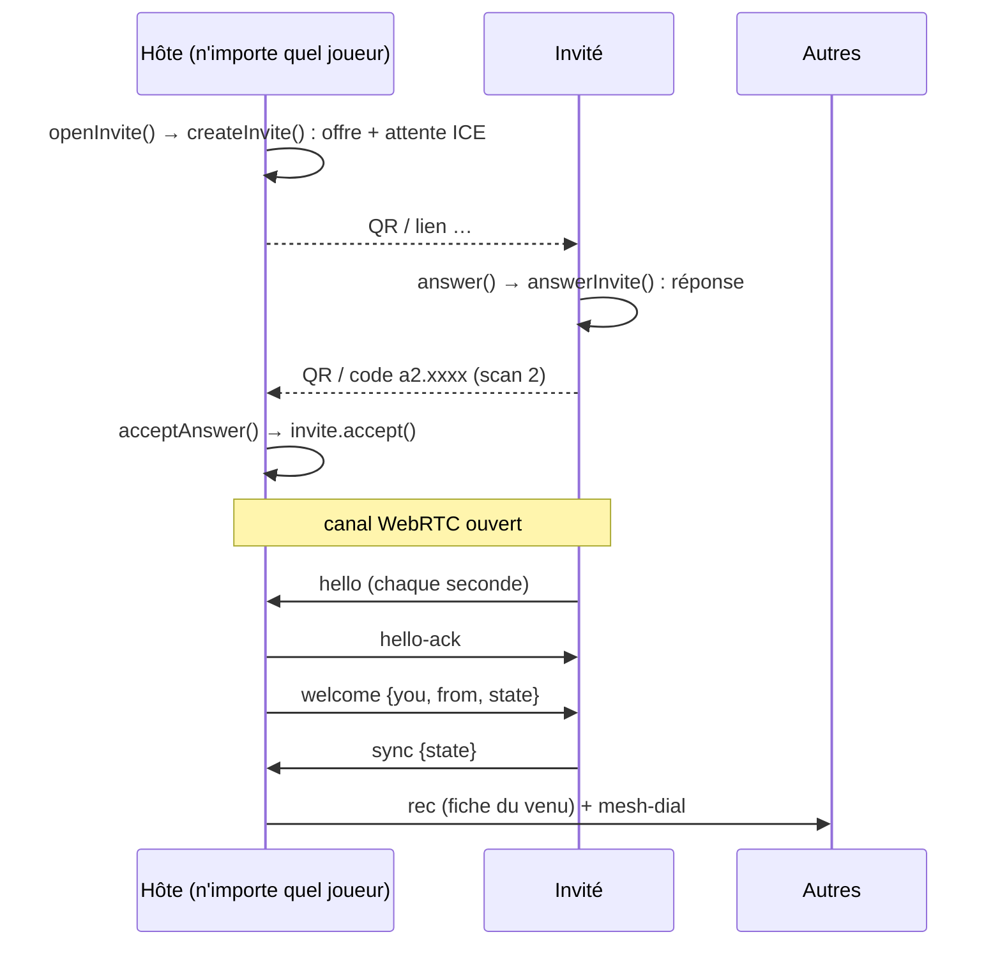

# Réseau et vie d'une partie

> Décrit le code au commit `1eeb2c1`. Dates et heures en UTC.
> Pour l'installation et la mise en ligne : voir `README.md`. Pour jouer : `GUIDE.md`.
> Les règles du jeu (ordres, flottes, combats, échanges, `tick`) sont dans `docs/architecture/regles.md` ;
> les écrans (`js/app.js`) dans `docs/architecture/interface.md`.

## 1. En une phrase

Il n'y a **aucun serveur de jeu**. Chaque téléphone garde une copie complète de la partie.
Chaque joueur est **le seul à écrire sa propre fiche** (`state.players[pid]`). Les fiches
voyagent de téléphone en téléphone ; pour une même fiche, **la plus récente (`actAt`) gagne**.
Comme personne n'écrit la fiche d'un autre, deux copies ne peuvent pas entrer en conflit
(`js/session.js:1-18`).

## 2. Vue d'ensemble

```
             ┌──────────── js/app.js (écrans) ────────────┐
             │  scanQr  drawQr/inviteLink/decode  save.*   │
             └──────┬─────────────┬───────────────┬────────┘
                    │             │               │
              js/scanner.js  js/invite.js     js/save.js ──► localStorage
              (caméra+jsQR)  (SDP ⇄ code)     (copie locale, identité)
                                  ▲
             ┌────────────────────┴──── js/session.js (Session) ─────────────┐
             │ état partagé, messages, fusion, maillage, sauvegarde           │
             └───────┬──────────────────────────────┬────────────────────────┘
                     │                              │
                js/peer.js                    js/rendezvous.js
         Link = canal WebRTC direct       RoomLink = pair trouvé via Trystero
         (QR, ou SDP relayé par un        sur des relais Nostr publics
          joueur déjà connecté)            (vendor/trystero-nostr.mjs)
                     │                              │
                     └── STUN Cloudflare (js/config.js) ──┘
```

Deux sortes de liens, **même interface** (`send`, `onmessage`, `onclose`, `close`, `route`,
`closed`) : `Link` (`js/peer.js:44`) et `RoomLink` (`js/rendezvous.js:39`). `Session` ne fait
pas la différence, sauf `link.viaRoom` (voir §6, `attach`).

## 3. Rôle de chaque fichier

| Fichier | Rôle |
|---|---|
| `js/config.js` | `ICE_SERVERS` (STUN Cloudflare seul, TURN en commentaire) l.9 ; `relayUrls()` l.16 lit `localStorage['astra.relays']` (relais Nostr perso, sinon `null` = relais publics de Trystero) ; `ICE_GATHER_TIMEOUT_MS = 3500` l.26. |
| `js/peer.js` | WebRTC brut sans serveur de signalisation. `Link` (enveloppe d'un data channel, JSON, découpage en morceaux). Invitations par QR : `createInvite` l.153 / `answerInvite` l.217. Connexions relayées : `makeOffer` l.251 / `makeAnswer` l.269. |
| `js/invite.js` | Compresse un SDP en code court `o2.<base64url>` (offre) ou `a2.<base64url>` (réponse), ~150 caractères, et le reconstruit. `encode` l.187, `decode` l.195, `inviteLink` l.210, `drawQr` l.215. |
| `js/scanner.js` | `scanQr(video, {signal})` l.22 : caméra arrière + jsQR chargé à la demande (`loadJsQR` l.6). |
| `js/rendezvous.js` | Reconnexion automatique sans rescanner : salon Trystero/Nostr propre à la partie, chiffré par la clé de la partie. Classe `Rendezvous` l.82. |
| `js/session.js` | Classe `Session` l.197 : création/arrivée, messages, fusion des copies, maillage, sauvegarde. Contient aussi toutes les règles (l.696-1771, voir `regles.md`). |
| `js/save.js` | Copie locale de la partie et identité dans `localStorage` ; historique de 10 parties ; `mergeStates` (fusion de deux copies). |
| `sw.js` | Service worker : cache hors ligne, « réseau d'abord ». |
| `manifest.json` | Appli installable (PWA) : nom Astra, `display: standalone`, portrait, icônes 192/512/svg. |
| `vendor/` | Bibliothèques tierces copiées telles quelles (pas de build, voir `vendor/README.txt`) : `qrcode.mjs` (qrcode-generator 2.0.4, dessin des QR), `jsQR.js` (jsQR 1.4.0, lecture des QR), `trystero-nostr.mjs` (Trystero 0.26.0 stratégie Nostr + @noble/secp256k1, empaqueté par esbuild). |
| `tests/peer.test.mjs` | Test du découpage des gros messages de `Link`. |
| `tests/harness.mjs` | Banc d'essai : plusieurs `Session` dans Node, sans réseau. |

## 4. Fonctions et objets principaux

### js/peer.js
- `waitIce(pc)` l.8 : attend la fin de la collecte des adresses ICE, ou 3,5 s (sans STUN, on part avec les adresses locales). Nécessaire car l'offre et la réponse ne sont échangées **qu'une fois** (pas de « trickle ICE »).
- `earlyBuffer(channel)` l.28 : garde les messages arrivés avant que le `Link` soit créé.
- `class Link` l.44 :
  - `send(msg)` l.107 : `JSON.stringify` ; si le texte dépasse `PART = 60 000` caractères (l.39), envoi en morceaux `{type:'part', id, i, n, data}`. Rien n'est envoyé si le canal n'est pas `open`.
  - réception l.53-73 : recolle les morceaux ; refuse `n` hors de `1..MAX_PARTS` (200, l.41) ; JSON invalide ignoré en silence.
  - `onmessage` (setter l.99) : rejoue d'abord la file des messages déjà reçus.
  - fermeture l.76-91 : `onclose` appelé une seule fois ; état WebRTC `failed`/`closed` → fermé tout de suite ; `disconnected` → fermé seulement s'il dure 5 s.
  - `route()` l.125 : type de chemin (`host` | `srflx` | `prflx` | `relay`) lu dans `getStats()`.
- `createInvite()` l.153 → `{ code, used, accept(answer), cancel() }`. `accept` : refuse un code d'offre ; la même réponse scannée deux fois (même `ice-ufrag`) renvoie la connexion déjà en cours ; une autre réponse → erreur `used` (« Cette invitation a déjà servi. ») ; délai 25 s.
- `answerInvite(offer)` l.217 → `{ code, link, cancel }`. `link` échoue après 180 s si l'hôte n'a pas scanné la réponse.
- `makeOffer()` l.251 / `makeAnswer(sdp)` l.269 : même chose mais SDP complet, sans compression (il passe par un canal déjà ouvert). Délais 25 s / 30 s.

### js/invite.js
- Ne garde du SDP que : `setup`, `ice-ufrag`, `ice-pwd`, empreinte DTLS (sha-256/384/512), candidats UDP composant 1 (12 au plus, l.110). Adresses packées : IPv4, IPv6, mDNS `<uuid>.local`, ou texte (l.67).
- `buildSdp` l.143 reconstruit un SDP « data channel seul » avec `a=max-message-size:262144` (l.166) — d'où la limite de 256 Ko qui justifie le découpage de `Link`.
- `unpack` l.120 valide ufrag/pwd et adresses par expressions régulières (pas de retour à la ligne injecté dans le SDP).
- `decode(input)` l.195 accepte un code brut ou un lien entier (prend ce qui suit `#`). Erreurs lisibles : pas une invitation Astra ; autre version (`VERSION = '2'`, l.16) ; code abîmé.
- `inviteLink(code)` l.210 : `origin + pathname + '#' + code`. Le `#` n'est jamais envoyé à l'hébergeur.

### js/rendezvous.js
- `APP_ID = 'astra-vincentbee-p2p'` l.17, salon `g-<gid>` l.118, `password: state.key` l.114 (Trystero chiffre les offres avec), action `'astra'` l.18.
- `Rendezvous` l.82 : `join()` l.98 (charge Trystero à la demande, état `off | joining | on | failed`), `refresh()` l.180 (quitte et rejoint, au réveil), `leave()` l.186, `drop(peerId)` l.171.
- `onPeerJoin` l.132 : crée un `RoomLink` et envoie `rdv-hello` chaque seconde jusqu'à recevoir celui de l'autre. `onData` l.149 : un `rdv-hello` d'une autre partie ou avec mon propre pid ferme le lien ; sinon `onLink(link, pid)`. Les messages ne passent au `RoomLink` qu'une fois le pid connu.
- `routeOf(pc)` l.23 est une copie de `Link.route()`.

### js/save.js
Clés `localStorage` (l.13-16) :

| Clé | Contenu |
|---|---|
| `astra.save` | partie en cours `{ v: 1, me, savedAt, state, journal? }` (`journal` : mon carnet de combats, D-110, propre au téléphone) |
| `astra.saves` | historique `{ gid: sauvegarde }`, 10 plus récentes (`KEEP`, l.17) |
| `astra.identity` | mon identité dans la partie en cours `{ gid, pid, secret }` |
| `astra.identities` | historique `{ gid: identité }` |

Autres clés lues ailleurs : `astra.relays` (`js/config.js:18`), `astra.name` (`js/app.js:133`), `astra.sky` (réglage « Fond », `js/galaxy.js`, D-112).

- `saveGame(me, state, journal)` l.37 (`journal` facultatif ; `Session.resume` et `onWelcome` le reprennent, même partie et même joueur), `loadGame()` l.44, `listGames()` l.58, `selectGame(gid)` l.65 (la remet en cours, avec son identité), `forgetGame(gid)` l.75, `saveIdentity(id)` l.99, `loadIdentity()` l.96, `describeSave(save)` l.138.
- `js/replay-view.js:5` lit `loadGame()` : c'est pourquoi « Revoir » fait d'abord `selectGame(gid)` puis ouvre `replay.html` (`app.js:182-184`).
- `mergeStates(base, other)` l.111 : même `gid` obligatoire ; pour chaque joueur, garde la fiche au plus grand `actAt` (`base` gagne à égalité) ; garde `online` de `base` ; journal = union sans doublon (`at|text`), trié, 40 dernières entrées.

### js/session.js (partie réseau)
Découpage convenu avec code-regles : **ici** constructeur, création/arrivée, connexions, messages, fusion, maillage, invitations, sauvegarde, `normalize`/`clean`/garde-fous ; **dans `regles.md`** `addPlayer` et tout ce qui va de `chooseRace` (l.722) à `fleetHit` (l.1771), ainsi que le sens du journal d'ordres pour le rejeu.

| Élément | Ligne | Rôle |
|---|---|---|
| `FORMAT = 9` (D-120) | 41 | Version du format des fiches, écrite dans `p.v` par `touch`. `outdated` (l.1812) est vrai si un autre a un `v` plus grand → `app.js:830` prévient de recharger. |
| constantes | 54-72 | `MAX_PLAYERS = 8`, `HEARTBEAT_MS = 1500`, `SILENCE_MS = 30000`, `MAX_ORDERS = 1500`. |
| `normalize(p)` | 90 | Remet une fiche reçue au format actuel et la nettoie (nom ≤ 16, couleur `#rrggbb`, race connue, planètes valides via `planetOk` l.141, quantités bornées via `cleanAmounts` l.158, etc.). Exportée (utilisée par `js/replay.js`). |
| `pidOk(pid)` | 169 | `[A-Za-z0-9-]{1,24}` : pas de `__proto__`. |
| `clean(state)` | 187 | Copie + suppression des champs d'anciennes versions (`leader`, `epoch`, `nextRank`) + `normalize` de chaque fiche. |
| `Session.create(name)` | 214 | Nouvelle partie : `gid` (6), `key` (16), `me` (6), secret (16) dont seul le hash SHA-256 va dans la fiche. |
| `Session.resume(saved)` | 234 | Reprise d'une sauvegarde ; `tick()` rattrape le temps écoulé. |
| `answer(offer)` | 247 | Invité : répond à une invitation, statut `answering`. |
| `onFirstLink(link)` | 265 | Invité : canal ouvert, envoie `hello` chaque seconde jusqu'à `hello-ack`/`welcome`/`refused`. |
| `start()` | 296 | Rejoint le rendez-vous (`meet`), lance `heartbeat` (1,5 s) et `tick` (250 ms), écoute `visibilitychange` (sauvegarde quand caché, `rdv.refresh()` au réveil si seul). |
| `now()` / `newId()` | 319 / 327 | Heure figée pendant un ordre (`entry.t`) ; identifiants notés dans l'ordre pour le rejeu. |
| `attach(link, pid)` | 350 | Branche un lien. Si un lien **rendez-vous** vivant existe déjà pour ce pid, un nouveau lien direct est fermé. Sinon le nouveau remplace l'ancien. |
| `heartbeat()` | 371 | `hb` à chaque voisin ; ferme un lien muet depuis 30 s ; met à jour `routeType`. |
| `onLinkClosed` | 383 | Invité coupé avant d'être accepté → `failed`. Sinon retire le lien. |
| `onMessage` | 399 | Aiguillage des messages (§5). |
| `onHello` | 445 | Hôte : accueil d'un nouveau ou retour d'un ancien joueur. |
| `admit` | 476 | Envoie `welcome`, diffuse la fiche du venu, demande aux autres de l'appeler (`mesh-dial`). |
| `onWelcome` | 486 | Invité : adopte la copie de l'hôte, fusionnée avec sa copie locale si même partie. |
| `mergeIn(st, from)` | 510 | Fusion d'une copie complète reçue ; rediffuse les fiches devenues plus récentes. |
| `recordOk(pid, rec)` | 536 | Garde-fou de réception (§8). |
| `backdated` | 554 | Planète mère revendiquée avec une date antérieure à la fiche connue (marge 1 min). |
| `onRecord` | 560 | Fiche unique reçue (`rec`) : acceptée si plus récente, rediffusée. |
| `spread(rec, log, except)` | 576 | Envoie une fiche (sans `online`) à tous les voisins sauf la source. |
| `touch(log)` | 584 | J'ai changé ma fiche : `actAt = max(now, actAt+1)`, `v = FORMAT`, ajout de l'ordre en cours au journal `orders`, diffusion. |
| `gameKey` / `meet()` / `onRoomLink` | 599 / 604 / 619 | Rendez-vous automatique. Parties sans `key` : clé `k-<gid>`. |
| `dial` / `onSignal` | 628 / 643 | Maillage : un joueur déjà connecté relaie l'offre et la réponse. |
| `openInvite` / `acceptAnswer` / `cancelInvite` | 674 / 680 / 689 | Invitations (tout joueur peut inviter). |
| `addLog` / `pushLog` | 1772 / 1779 | Journal de partie : 120 caractères par entrée, 40 entrées gardées. |
| `snapshot()` | 1787 | Copie envoyée : journal limité aux 20 dernières entrées, champ `online` retiré. |
| `changed()` / `scheduleSave()` / `save()` | 1793 / 1799 / 1807 | Sauvegarde immédiate après action ; différée de 500 ms à la réception d'une fiche. On ne sauve que si `status === 'playing'`. |
| `peerCount` / `alone` | 1817 / 1822 | Nombre de liens ; « seul alors que la partie a d'autres joueurs ». |
| `end()` | 1826 | Sauve, arrête minuteurs, invitations, liens et rendez-vous. |
| enveloppe des ordres | 1872-1893 | Voir §7. |

## 5. Messages échangés

Tous en JSON. Au niveau transport :

| Type | Émis par | Contenu | Où |
|---|---|---|---|
| `part` | `Link.send` | `id, i, n, data` (morceau de texte JSON) | `peer.js:113`, recollé l.57-67 |
| `rdv-hello` | `Rendezvous` | `gid, pid` | `rendezvous.js:138`, `:158` |

Au niveau partie (`session.js:399-442`) :

| Type | Sens | Contenu | Effet |
|---|---|---|---|
| `hb` | tous | `t0` | Répondu par `hb-ack`. |
| `hb-ack` | tous | `t0` | `link.rtt` (latence). |
| `hello` | invité → hôte | `name, gid?, pid?, secret?, secretHash, copy?` | Demande d'entrée. `gid/pid/secret` = identité gardée (retour d'un joueur) ; `secretHash` = hash d'un nouveau secret ; `copy` = **toute** la copie locale (c'est surtout pour ces gros messages que `part` existe). Renvoyé chaque seconde. |
| `hello-ack` | hôte → invité | — | « Demande reçue » ; arrête les renvois. |
| `welcome` | hôte → invité | `you, from, state` | Entrée acceptée : mon pid, celui de l'hôte, copie complète. |
| `refused` | hôte → invité | `reason` | Partie complète (8 joueurs). Lien fermé 300 ms après. |
| `sync` | tous | `state` | Copie complète → `mergeIn`. Envoyé après `welcome`, au rendez-vous, après une connexion maillée. |
| `rec` | tous | `rec, log?` | Une fiche à jour (+ jusqu'à 10 entrées de journal) → `onRecord`. |
| `mesh-dial` | hôte → anciens | `peer` | « Appelle ce nouveau joueur » → `dial`. |
| `signal` | tous | `to?/from?, kind: 'offer'\|'answer', sdp` (≤ 8 000) | SDP relayé par un voisin commun → `onSignal`. |

`sync`, `rec`, `signal`, `mesh-dial` ne sont acceptés que sur un lien dont le pid est connu.

## 6. Cycle de vie d'une partie

### 6.1 Créer
`app.js:197` → `Session.create(name)` : partie neuve, statut `playing`, `start()` (rendez-vous + minuteurs), sauvegarde.

La partie ne part qu'ensuite (D-120) : chaque joueur se dit prêt (champ `ready` de sa fiche) ;
quand un téléphone voit prêts tous les joueurs **en ligne avec lui** (`online`, moi compris), il
écrit `go` dans sa fiche (ordre `begin`). Ce champ se propage comme le reste de la fiche ; le
départ est le plus petit `go` vu. Le minuteur de 250 ms appelle `tick` puis `checkStart`.
`FORMAT` passe à 9 : un téléphone d'avant, qui ne connaît pas `go`, est prié de recharger.

### 6.2 Inviter : le double scan



- Le schéma montre un **nouveau** joueur. Un joueur **de retour** (secret valide, `session.js:457-459`) reçoit directement `welcome` via `admit`, sans `hello-ack` (`welcome` arrête lui-même les renvois, l.419).
- Le lien `#o2…` ouvert dans le navigateur mène à l'écran « rejoindre » (`app.js:1935-1958`). Un lien `#a2…` est reconnu comme une réponse et refusé avec un message.
- Pas de validation par l'hôte : avoir scanné la réponse vaut accord (`session.js:463`).
- Si l'invitation a déjà servi ou si la connexion échoue, l'écran en prépare une neuve (`app.js:351-357`).
- Rejoindre ferme la session en cours (`session?.end()`, `app.js:243`) ; l'identité reste gardée.

### 6.3 Maillage
Après `admit`, l'hôte envoie `mesh-dial {peer}` à ses autres voisins. Chacun appelle `dial` : `makeOffer`, puis `signal {to, kind:'offer'}` via l'hôte, qui relaie avec `from`. Le nouveau répond (`makeAnswer`) par le même chemin. Les offres non abouties sont annulées après 30 s. Résultat : tout le monde est relié directement.

### 6.4 Reconnexion
Trois chemins :
1. **Rendez-vous automatique** (`meet`, l.604) : à chaque `start()` et au réveil si seul. Les téléphones de la partie se trouvent dans le salon Trystero `g-<gid>`, se présentent (`rdv-hello`), puis échangent `sync`. Ne marche qu'avec Internet. La clé `state.key` arrive chez un invité dans la copie de `welcome`.
2. **Maillage** (§6.3), à l'arrivée d'un joueur.
3. **Rescanner une invitation** : `hello` porte `gid/pid/secret` ; l'hôte vérifie `sha256(secret)` avec le hash qu'il connaissait **avant** de fusionner la copie apportée (l.452), puis `admit` sans nouveau joueur.

Un pair qui arrive par le rendez-vous et par un lien direct garde le lien rendez-vous (`attach`, l.352).

### 6.5 Sauvegarde et reprise
- Sauvegarde à chaque `changed()` (après action), différée de 500 ms à la réception d'une fiche, à `visibilitychange` caché, à `pagehide` (`app.js:191`), à `end()`.
- Écran d'accueil : `listGames` → reprendre (`selectGame` + `Session.resume`), revoir (`replay.html`), oublier (`forgetGame`) (`app.js:153-189`).
- Une partie « continue » hors connexion : tout se calcule depuis le temps écoulé ; à la reprise `tick()` rattrape.
- Copies jouées séparément : fusion par fiche (`mergeStates`), à `welcome` (copie locale), à `hello` (copie de l'invité), à chaque `sync`.

### 6.6 Départ d'un joueur
Il n'y a **pas de message « je pars »**. Un départ = un lien qui se ferme : silence de 30 s (`heartbeat`), état WebRTC `failed/closed`, ou `disconnected` pendant 5 s. Le joueur passe hors ligne (`refreshOnline`) ; **sa fiche reste dans la partie**. Quitter l'écran (`data-go`, `app.js:137`) appelle `end()`. Resté seul (`alone`), l'écran montre un bouton pour rejoindre les autres (`app.js:289`, `762`).

## 7. Ordres et synchronisation

`session.js:1872-1893` enveloppe chaque méthode de `ORDER_KINDS` et `tick` :
- crée `this.entry = { t, k, a?, s? }` ; `now()` renvoie `entry.t` pendant l'ordre (heure figée) ;
- un ordre appelé dans un ordre n'est pas noté deux fois ;
- même un ordre **refusé** appelle `touch()` (nouvel `actAt`) et `scheduleSave()`, pour que les autres adoptent la fiche ;
- `touch` ajoute l'entrée au journal `p.orders` (1 500 au plus) qui voyage avec la fiche.
Le sens de ce journal pour le rejeu (`seenNews`, `replayIds`) est décrit dans `regles.md`.

## 8. Invariants et pièges

**Invariants**
- Personne n'écrit la fiche d'un autre : `recordOk` refuse une fiche à mon pid (l.537).
- Le `secretHash` d'un joueur ne change jamais (l.545). Le secret lui-même n'est que dans `astra.identity`.
- Une fiche datée de plus de 24 h dans le futur est refusée (l.540).
- Plus de `MAX_PLAYERS * 2` = 16 fiches : les fiches inconnues sont ignorées (l.517, l.564).
- Toute donnée reçue passe par `normalize`/`clean` avant usage.
- `snapshot()` n'envoie jamais `online`.

**Pièges**
- `clean()` supprime `epoch` et `nextRank`, `mergeStates` les recalcule, `mergeIn` les supprime à nouveau (l.521). Ce sont des restes d'anciennes versions.
- `actAt` repose sur l'horloge du téléphone ; d'où la marge d'un jour (l.540) et d'une minute (l.556).
- `Link.send` ne fait rien si le canal n'est pas ouvert : pas d'erreur.
- Un message de plus de 256 Ko dépasserait la limite annoncée par `a=max-message-size` (`invite.js:166`, `peer.js:35`) : passer toujours par `Link.send`, qui découpe.
- Changer le format du code d'invitation : changer `VERSION` dans `invite.js` (sinon décodage faux).
- Changer le format des fiches : incrémenter `FORMAT` et compléter son commentaire (l.32-40).
- `sw.js` : changer `VERSION` (`astra-p2p-v53` au 2026-10-30) à chaque mise en ligne. `cache.addAll` est tout ou rien : un fichier absent de `FILES` qui renvoie 404 casse l'installation.
- **`technologies.html` et `js/techtree.js` ne sont pas dans `FILES`** (`sw.js:5-34`). Ils ne sont pas pré-cachés ; ils ne marchent hors ligne que s'ils ont déjà été ouverts en ligne (le `fetch` met en cache ce qu'il télécharge, l.53-57).
- Le service worker n'est enregistré qu'en https ou sur `localhost` (`app.js:1964`). La caméra aussi exige https (`scanner.js:25`).
- `route()` est copié dans `peer.js:125` et `rendezvous.js:23`.
- Pas de TURN : derrière certains opérateurs (CGNAT), la connexion peut échouer (`config.js:6-8`).

## 9. Comment tester

Pas de `package.json` : on lance Node directement (Node 24.14.1 ici).

```bash
node --test tests/peer.test.mjs
```
Résultat (2026-10-29) : 1 test, 1 réussi — un message de 600 000 caractères arrive entier en morceaux de moins de 64 000.

```bash
node --test tests/*.test.mjs
```
Résultat (2026-10-29) : 35 tests, 35 réussis, 0 échec (≈ 5,7 s).

⚠️ `node --test tests/` échoue : Node prend le dossier pour un fichier de test.

- `tests/harness.mjs` simule `localStorage`, `document`, `window`, fixe l'heure (`clock.t`) et crée `n` sessions. Son `sync(a, b)` est `a.mergeIn(b.snapshot(), {pid: b.me})` : il **contourne** `peer.js` et `rendezvous.js`. Les tests ne vérifient donc ni WebRTC, ni QR, ni Nostr.
- `tests/hostile.test.mjs` teste les garde-fous de réception (`recordOk`, `normalize`, `backdated`, horloges décalées) ; certains de ses tests touchent aussi aux règles (ex. heure qui recule et production).
- Test manuel : servir le dossier en https ou `localhost` et ouvrir deux navigateurs (pas à pas à jour : [interface.md](interface.md) §2 ; celui de `README.md` est périmé). Pour un relais Nostr à soi : `localStorage['astra.relays'] = 'wss://…'`.

## 10. Pourquoi c'est fait ainsi (renvois vers l'historique)

Les numéros D-xxx renvoient à [decisions.md](../decisions.md) ; les demandes datées sont dans [journal.md](../historique/journal.md). Le code ci-dessus est la référence ; ces lignes expliquent seulement l'origine.
- Découpage des messages en morceaux : limite de 256 Ko par message WebRTC (commit `7f5fabe`, D-046 ; journal des ordres D-044, ordres refusés notés D-045).
- Journal des ordres dans chaque fiche, plafonné à 1 500 entrées, avec le compte des entrées des autres connues (`69d687e`, D-049, D-050).
- Historique de 10 parties et identité gardée par partie (`astra.saves`, `astra.identities`, `1eeb2c1`, D-066).
- Garde-fous de réception (`recordOk`, `backdated`, tolérance d'horloge d'un jour au lieu de 10 min) : `061744b`, D-061.
- Assumé, non corrigé : un joueur qui modifie son code peut inventer un combat dans sa propre fiche ; signer les fiches a été jugé trop lourd (D-057).
- `technologies.html` non mis en cache par `sw.js` : déjà signalé le 2026-10-28 à 15:12 (session `01be156b`), toujours vrai au commit 1eeb2c1.
